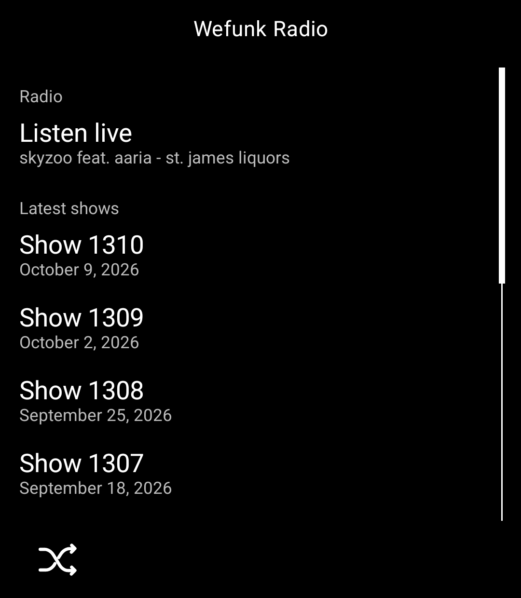
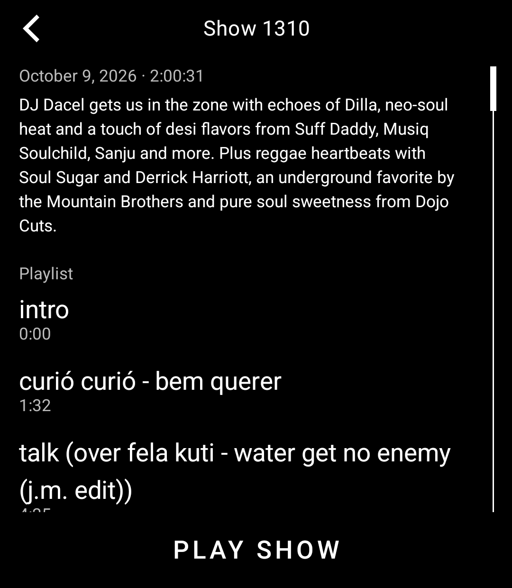
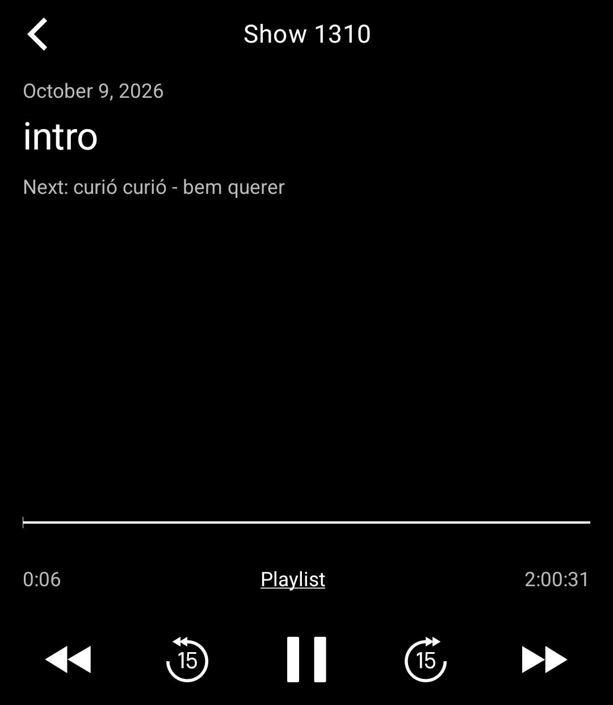

# Wefunk Radio for the Light Phone III

An unofficial [WEFUNK Radio](https://www.wefunkradio.com) tool for the Light Phone III, built with the
[Light SDK](https://github.com/lightphone/light-sdk).

- Listen to the live stream, with the current track shown
- Browse the show archive and read each show's notes and playlist
- Play any past show, skip between tracks, jump 15 seconds back or forward
- Audio keeps playing when you leave the tool

  
  
  

The tool reads WEFUNK's public web pages, the same ones the website's player uses. There is no account and no
setup. All music and show content belongs to WEFUNK and the artists; this project is not affiliated with WEFUNK.

## Install

You need JDK 21, the Android SDK and `adb`, and a Light Phone III you can sideload tools onto over ADB.

1. In `tool/lighttool.toml`, switch `serverPackage` to `"com.lightos"` (the committed value targets the LightOS
   emulator).
2. Build: `./gradlew :tool:assembleDebug`
3. Install: `adb install -r tool/build/outputs/apk/debug/tool-debug.apk`

To run it in the LightOS emulator instead, keep the committed `serverPackage` and build with
`./gradlew :tool:assembleDebug -DlightSdk.allowAltServerPackage=true`.

The tool's code is in [`tool/`](../tool). Everything else in this repository is the Light SDK (MIT licence); the
SDK's own README is [`README.md`](../README.md).
